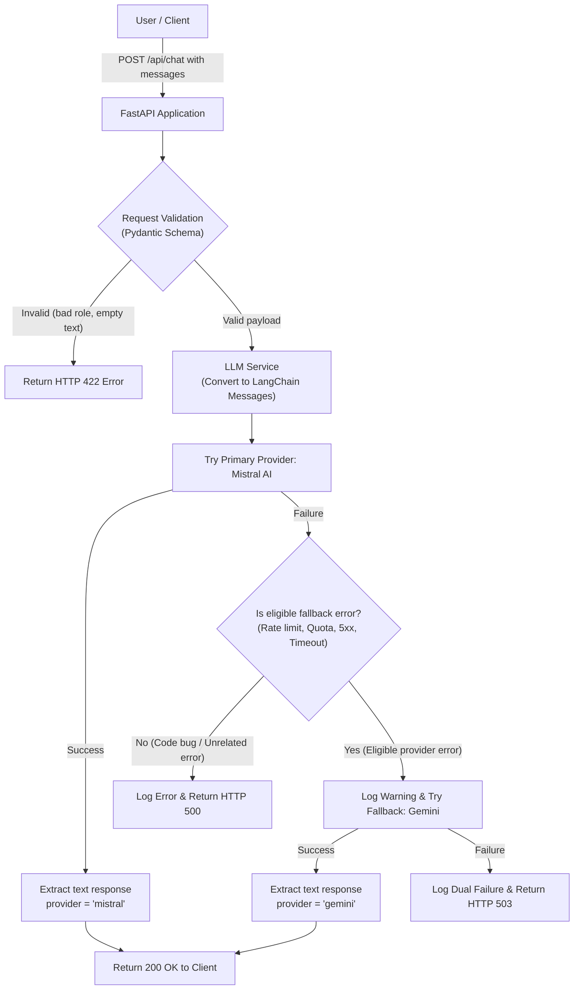

# Phase 1: Basic AI Chatbot Backend Documentation

## 1. Overview

The goal of Phase 1 is to build a reliable, lightweight backend API for the **GenAI-Chatbot** project.

In this phase, the backend provides:
- A health check route to verify that the server is alive.
- A chat completion API that supports multi-turn conversation messages.
- An automatic fallback mechanism: **Mistral AI** acts as the primary Large Language Model (LLM). If Mistral encounters rate limits, quota exhaustion, or temporary server outages, the system automatically redirects the request to **Google Gemini** without losing the conversation history.

---

## 2. Backend Folder Structure

The backend follows a clean, modular structure where each folder has a single, well-defined responsibility:

```
backend/
├── main.py
├── requirements.txt
├── .env
└── app/
    ├── __init__.py
    ├── config.py
    ├── routes/
    │   ├── __init__.py
    │   └── chat.py
    ├── services/
    │   ├── __init__.py
    │   └── llm_service.py
    └── schemas/
        ├── __init__.py
        └── chat.py
```

### File Responsibilities

- **`main.py`**: The entry point for the FastAPI application. It creates the FastAPI app instance, configures CORS (Cross-Origin Resource Sharing) middleware, defines the `/health` endpoint, and mounts the chat router.
- **`app/config.py`**: Central configuration module. It locates and reads `backend/.env` using `python-dotenv`, exposes the API keys (`MISTRAL_API_KEY` and `GOOGLE_API_KEY` / `GEMINI_API_KEY`), and defines default model identifiers (`mistral-small-latest` and `gemini-3.5-flash-lite`).
- **`app/schemas/chat.py`**: Defines Pydantic data models for data validation. It ensures incoming messages use only valid roles (`user` or `assistant`), prevents empty messages, and defines the structure of the chat response.
- **`app/routes/chat.py`**: Exposes the `POST /api/chat` route using FastAPI's `APIRouter`. It receives the validated request payload and forwards it to the LLM service.
- **`app/services/llm_service.py`**: Implements the core AI logic. It converts chat messages into LangChain message objects, calls Mistral first, checks whether any errors qualify for automatic fallback, invokes Gemini if needed, extracts the final text response, and handles dual provider failures safely.
- **`requirements.txt`**: Lists the exact Python packages and libraries required to run the backend application.
- **`.env`**: Stores sensitive configuration values locally (such as API keys). This file is never exposed through API responses or committed to public version control.

---

## 3. Technologies and Dependencies

The backend relies on the following core libraries (defined in `requirements.txt`):

- **FastAPI**: A modern, high-performance web framework for Python used to create the REST API endpoints, handle request validation, and generate interactive OpenAPI documentation.
- **Uvicorn (`uvicorn[standard]`)**: An ASGI web server used to run the FastAPI application with fast asynchronous performance and auto-reload support during development.
- **LangChain (`langchain-core`)**: Provides the message abstraction framework (`HumanMessage` and `AIMessage`) to format chat history consistently across different AI providers.
- **`langchain-mistralai` (`ChatMistralAI`)**: The official LangChain integration for Mistral AI, used as the primary chat model.
- **`langchain-google-genai` (`ChatGoogleGenerativeAI`)**: The LangChain integration for Google Generative AI, used to connect to Google Gemini as the fallback model.
- **Pydantic**: Data parsing and validation library used by FastAPI to validate incoming JSON payloads and enforce strict types for message roles and contents.
- **`python-dotenv`**: Loads environment variables from the `backend/.env` file into Python's `os.environ`.

---

## 4. API Endpoints

### 4.1 `GET /health`

Checks if the FastAPI backend service is operational.

- **Method**: `GET`
- **URL**: `/health`
- **Request Body**: None
- **Response Status**: `200 OK`
- **Example Response**:
```json
{
  "status": "ok",
  "message": "GenAI Chatbot backend is running"
}
```

---

### 4.2 `POST /api/chat`

Processes a chat conversation and returns an AI-generated assistant response.

- **Method**: `POST`
- **URL**: `/api/chat`
- **Request Headers**: `Content-Type: application/json`
- **Allowed Roles**: `"user"` and `"assistant"`
- **Response Fields**:
  - `role`: The role of the responder (always `"assistant"`).
  - `content`: The text reply generated by the LLM.
  - `provider`: Indicates which model provider fulfilled the request (`"mistral"` or `"gemini"`).

#### Example Request Body
```json
{
  "messages": [
    {
      "role": "user",
      "content": "Hello! I am planning a weekend trip."
    },
    {
      "role": "assistant",
      "content": "That sounds great! Where would you like to go?"
    },
    {
      "role": "user",
      "content": "A quiet mountain town."
    }
  ]
}
```

#### Example Successful Response (Mistral)
```json
{
  "role": "assistant",
  "content": "A quiet mountain town is a wonderful choice for relaxing. You could consider places like Aspen, Estes Park, or Stowe.",
  "provider": "mistral"
}
```

#### Example Successful Response (Gemini Fallback)
If Mistral reaches a rate limit or encounters an outage, the system falls back to Gemini:
```json
{
  "role": "assistant",
  "content": "A quiet mountain getaway sounds perfect! Depending on where you live, you might enjoy visiting Blue Ridge, Georgia, or Lake Placid, New York.",
  "provider": "gemini"
}
```

#### Error Responses
- **`422 Unprocessable Entity`**: Returned when the request body has an invalid structure, contains an unsupported role (e.g. `"admin"`), or contains empty/blank text content.
- **`503 Service Unavailable`**: Returned when both Mistral and Gemini fail to produce a response:
```json
{
  "detail": "Both primary (Mistral) and fallback (Gemini) AI providers are currently unavailable. Please try again later."
}
```

---

## 5. LLM Fallback Workflow

The fallback mechanism in `app/services/llm_service.py` ensures the chatbot remains available even during high traffic or provider interruptions.

1. **Primary Provider (Mistral)**:
   - Every chat request is first sent to Mistral AI via `ChatMistralAI` using model `mistral-small-latest`.
   - If Mistral responds successfully, the text is extracted and returned immediately with `"provider": "mistral"`.

2. **Error Classification & Fallback Criteria**:
   - The service inspects errors using `is_provider_fallback_error()`.
   - **Eligible errors for fallback include**:
     - HTTP `429` (Rate limits / Too Many Requests).
     - HTTP `402` or `403` (Tier restrictions, quota exhaustion, billing credit limits).
     - HTTP `408` or request timeouts (`TimeoutError`, network disconnects).
     - HTTP `500`, `502`, `503`, `504` (Temporary upstream server errors and gateway outages).
     - Error messages containing indicators such as `"rate limit"`, `"quota"`, `"resource exhausted"`, `"service unavailable"`, or `"overloaded"`.
   - **Ineligible errors (Do NOT trigger fallback)**:
     - Client errors such as invalid request formats, empty messages, or unsupported roles (these return `422` immediately).
     - Local programming bugs (e.g. `TypeError`, `KeyError`, `AttributeError`), which raise a standard `500 Internal Server Error`.

3. **Fallback Provider (Gemini)**:
   - When an eligible error occurs, a warning is logged on the server.
   - The exact same conversation messages are passed to Google Gemini via `ChatGoogleGenerativeAI` using model `gemini-3.5-flash-lite`.
   - If Gemini succeeds, the response is returned with `"provider": "gemini"`.

4. **Dual Provider Failure**:
   - If Gemini also fails, the backend catches the exception, logs it on the server, and returns a safe HTTP `503 Service Unavailable` status.
   - Internal API keys, secret credentials, and raw stack traces are never exposed to the client.

---

## 6. Conversation Context

- **How Context is Sent**:
  - The client application passes the entire ongoing conversation as an ordered list of message objects in the `messages` array:
    - `"user"` messages represent user questions or prompts.
    - `"assistant"` messages represent prior responses generated by the AI.
  - The backend maps these to LangChain's `HumanMessage` and `AIMessage` objects.
- **Context Preservation During Fallback**:
  - If Mistral fails, the exact same list of LangChain messages is forwarded to Gemini.
  - This ensures the fallback model has full knowledge of the conversation history.
- **Stateless Architecture**:
  - In Phase 1, the backend is **stateless**.
  - No messages or chat sessions are stored in a database yet.
  - The client is responsible for sending the full message history with each new request.

---

## 7. Workflow Diagram

The following flowchart illustrates the complete request lifecycle and decision tree:



---

## 8. How to Run and Test

### 8.1 Start the Backend Server

Open a terminal, activate your virtual environment, navigate to the `backend` directory, and run:

```bash
python -m uvicorn main:app --reload
```

The server will start locally at:
```
http://127.0.0.1:8000
```

### 8.2 Important URLs

- **Health Check Endpoint**: [http://127.0.0.1:8000/health](http://127.0.0.1:8000/health)
- **Interactive Swagger Documentation**: [http://127.0.0.1:8000/docs](http://127.0.0.1:8000/docs)
- **Alternative ReDoc Documentation**: [http://127.0.0.1:8000/redoc](http://127.0.0.1:8000/redoc)

### 8.3 Testing the Chat Endpoint

#### Using cURL (Terminal / Command Prompt)

```bash
curl -X POST "http://127.0.0.1:8000/api/chat" \
     -H "Content-Type: application/json" \
     -d "{\"messages\": [{\"role\": \"user\", \"content\": \"Hello, what is 2 + 2?\"}]}"
```

#### Using Python

```python
import requests

url = "http://127.0.0.1:8000/api/chat"
payload = {
    "messages": [
        {"role": "user", "content": "Hello! What can you help me with?"}
    ]
}

response = requests.post(url, json=payload)
print("Status Code:", response.status_code)
print("Response JSON:", response.json())
```

#### Using the Swagger UI
1. Open [http://127.0.0.1:8000/docs](http://127.0.0.1:8000/docs) in your browser.
2. Expand the `POST /api/chat` section.
3. Click **Try it out**.
4. Enter a JSON request in the body and click **Execute**.

---

## 9. Current Scope and Limitations

### Phase 1 Implemented Features
- [x] Basic FastAPI application with CORS enabled.
- [x] Working `/health` endpoint.
- [x] Chat completion route (`POST /api/chat`) accepting conversation history.
- [x] Strict input schema validation with Pydantic (`user` and `assistant` roles).
- [x] Primary LLM integration with Mistral AI.
- [x] Automatic fallback to Google Gemini on rate limits (429), quota limits, or server errors.
- [x] Preserved conversation context across LLM switches.
- [x] Safe error handling without credential leakage.
- [x] Modular directory structure (`config`, `routes`, `schemas`, `services`).

### Features Planned for Future Phases (Not Yet Implemented)
- [ ] **Database & Persistence**: Chat messages are not saved to a database (e.g., PostgreSQL). When the client closes, conversation history in memory is gone.
- [ ] **User Authentication & Sessions**: No user accounts, JWT tokens, or session IDs.
- [ ] **Frontend Web Interface**: The React web interface in `frontend/` has not been connected or built yet.
- [ ] **RAG (Retrieval-Augmented Generation)**: Vector databases (e.g., ChromaDB) and document search are not implemented in this phase.
- [ ] **Streaming Responses**: Responses are returned as complete JSON strings rather than Server-Sent Events (SSE) or WebSockets.
